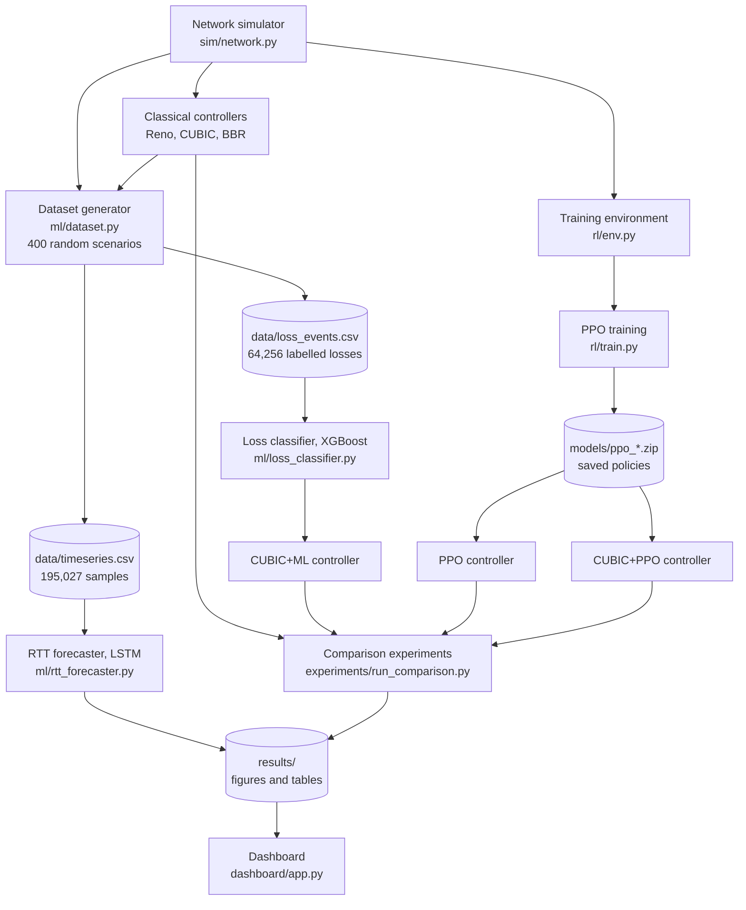
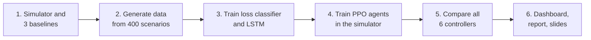
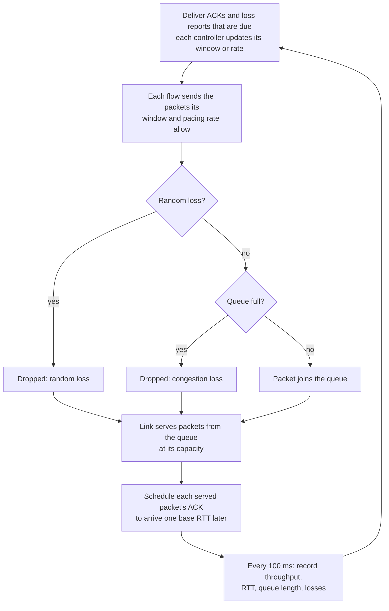
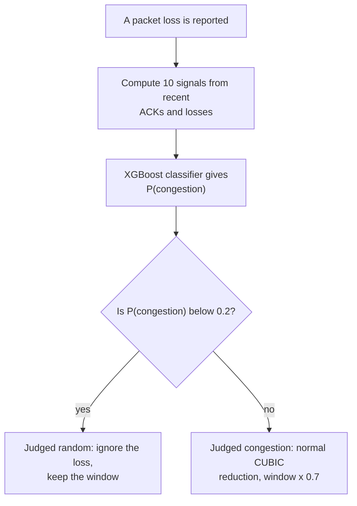
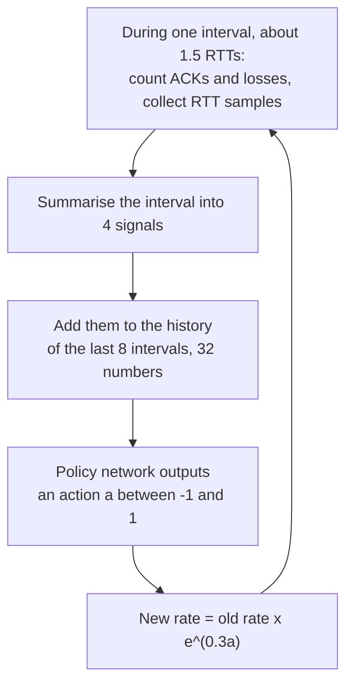
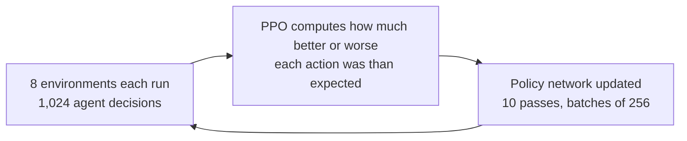

# Congestion Control using ML/DL

This project builds a network simulator, implements three classical TCP congestion controllers in it, and then builds three controllers that use machine learning, deep learning or reinforcement learning. All six are compared on throughput, delay, loss and fairness.

Later work fixes the reinforcement-learning agent's weaknesses and takes everything onto a real network: **PPO-Switch** lets the agent share a link fairly with CUBIC; **PPO-J** is retrained with random RTT jitter; a test over real Wi-Fi between two laptops checks every controller outside simulation; and **PPO-W** is trained on 29 minutes of recorded delay from that Wi-Fi, which raised the agent's real throughput from 0.3 to 5.8 Mbps.

Everything runs on a laptop CPU in Python. No GPU and no external network simulator is needed.

## Contents

1. [Project goal](#1-project-goal)
2. [Terms used in this document](#2-terms-used-in-this-document)
3. [Project flowchart](#3-project-flowchart)
4. [The simulator](#4-the-simulator)
5. [The six controllers](#5-the-six-controllers)
6. [Models used](#6-models-used)
7. [Machine learning: the loss classifier](#7-machine-learning-the-loss-classifier)
8. [Deep learning: the RTT forecaster](#8-deep-learning-the-rtt-forecaster)
9. [Reinforcement learning: the agents](#9-reinforcement-learning-the-agents)
10. [How everything is connected](#10-how-everything-is-connected)
11. [Experiments and results](#11-experiments-and-results)
12. [The dashboard](#12-the-dashboard)
13. [Setup and commands](#13-setup-and-commands)
14. [File map](#14-file-map)
15. [Limitations](#15-limitations)
16. [Real-network test](#16-real-network-test)

---

## 1. Project goal

### The problem

Congestion control is the part of TCP that decides how fast a sender transmits. If it sends too slowly, link capacity is wasted. If it sends too fast, the router's queue fills up, delay rises and packets are dropped.

The controllers used on the Internet today, such as Reno and CUBIC, follow fixed hand-written rules: keep increasing the sending window until a packet is lost, then cut the window. This has two known weaknesses.

| Weakness | What happens | What we measured |
|---|---|---|
| Every loss is treated as congestion | On a wireless or noisy link, packets are lost for reasons unrelated to congestion, and the sender slows down for nothing | CUBIC falls from 10 Mbps to 3.7 Mbps at 1% random loss |
| The sender reacts only after the queue overflows | The queue stays close to full, so every packet waits in it | Reno and CUBIC roughly double the round-trip time |

### The question

Can learned components fix these two weaknesses?

### Objectives

1. Build a packet-level simulator of a bottleneck link, and implement Reno, CUBIC and a BBR-style controller as baselines.
2. **Machine learning:** train a classifier that tells congestion loss from random loss, and use it inside CUBIC.
3. **Deep learning:** train an LSTM that forecasts a flow's round-trip time.
4. **Deep reinforcement learning:** train a PPO agent that sets the sending rate directly, and a hybrid in which PPO adjusts CUBIC.
5. Compare all six controllers, including on conditions not seen during training, and report honestly where the learned controllers fail.

### The answer in one paragraph

Yes for a flow that has the link to itself, and not yet for a shared link. The classifier fixes CUBIC's random-loss problem and stays fair to normal CUBIC. The PPO agent gives the best combination of throughput and delay of all six controllers when alone. But the PPO agent gets only 2% of a link when it shares it with a CUBIC flow, which is the project's main negative result.

---

## 2. Terms used in this document

| Term | Meaning |
|---|---|
| Flow | One sender transmitting data to one receiver |
| Bottleneck link | The slowest link on the path; it limits the flow's speed |
| RTT (round-trip time) | Time from sending a packet until its acknowledgement returns |
| Base RTT | The RTT when the queue is empty (twice the one-way delay) |
| ACK | Acknowledgement that a packet arrived |
| Congestion window (`cwnd`) | Maximum number of packets a sender may have in flight at once |
| Pacing rate | Packets per second a sender is allowed to send |
| Pipe size | Number of packets in flight that exactly fills the link with an empty queue (bandwidth × base RTT) |
| Congestion loss | A packet dropped because the queue was full |
| Random loss | A packet dropped by the link itself (for example wireless noise) |
| Utilisation | Throughput as a percentage of the link's capacity |
| Jain fairness index | 1.0 when all flows get equal throughput; 1/n when one flow takes everything |
| Controller | The algorithm that sets `cwnd` or the pacing rate |
| Agent | A controller whose decisions come from a learned reinforcement-learning policy |
| Policy | The trained neural network that maps what the agent observes to an action |

---

## 3. Project flowchart

The diagrams below are written in Mermaid. They render on GitHub and in VS Code with a Mermaid preview extension; without one they show as readable text.

### 3.1 The whole project

One simulator produces the training data, trains the agents and tests every controller.



### 3.2 Order in which the project was built



### 3.3 One time step of the simulator

The simulator repeats this loop once per simulated millisecond.



### 3.4 How CUBIC+ML handles a loss



### 3.5 The PPO agent's decision loop



---

## 4. The simulator

File: [sim/network.py](sim/network.py)

### What it models

```
sender 1 ──┐
sender 2 ──┼──► [ queue ] ──► bottleneck link ──► receivers
sender 3 ──┘                                          │
     ▲                                                │
     └──────────────── ACKs (never congested) ────────┘
```

| Setting | Meaning |
|---|---|
| `bandwidth_mbps` | Link capacity. A number, or a function of time for a link whose capacity changes |
| `delay_ms` | One-way propagation delay. Base RTT is twice this |
| `queue_pkts` | Queue size in packets. Drop-tail: a packet arriving at a full queue is dropped |
| `loss_rate` | Probability that the link itself drops a packet (random loss) |

### How it works

- Time moves in 1 ms steps. Packets are a fixed 1500 bytes.
- Within a step, packet departures and ACK arrivals get exact timestamps, so RTT measurements are not rounded to whole milliseconds.
- When several flows share the link, the flow that sends first rotates every step, so no flow gets a permanent advantage.
- Every lost packet is tagged with its true cause, `"congestion"` or `"random"`. Controllers are not allowed to read this tag. It is used only to label training data and to score results.
- Every 100 ms the simulator records each flow's throughput, average RTT, window, packets sent and lost, plus the queue length and link capacity.

### The controller interface

Any object with these members can be plugged into the simulator:

| Member | Purpose |
|---|---|
| `cwnd` | Congestion window in packets |
| `pacing_rate` | Packets per second, or `None` to send whenever the window allows |
| `on_ack(ack)` | Called for every ACK. The ACK carries the RTT, the delivery rate and packets in flight |
| `on_loss(loss)` | Called for every reported loss |
| `on_tick(now)` | Optional. Called every step; used by the RL agents for their interval timer |

All six controllers use this one interface, which is why they can be compared fairly and mixed on one link.

### Check that the simulator is correct

Reno's throughput under random loss has a known formula (Mathis et al.): throughput ≈ 1.22 × packet size / (RTT × √loss). For a 40 ms RTT and 1% loss this predicts 3.7 Mbps. The simulator gives 3.9 Mbps.

---

## 5. The controllers

| Controller | Type | File | How it decides |
|---|---|---|---|
| Reno | Classical | [baselines/reno.py](baselines/reno.py) | Doubles its window each RTT at the start, then adds one packet per RTT. Halves the window on loss |
| CUBIC | Classical | [baselines/cubic.py](baselines/cubic.py) | Window grows as a cubic function of time since the last loss. Multiplies the window by 0.7 on loss. This is the Linux default |
| BBR | Classical | [baselines/bbr.py](baselines/bbr.py) | Estimates the link's rate (highest recent delivery rate) and the base RTT (lowest recent RTT), then paces at the estimated rate. Ignores loss. Simplified version 1 |
| CUBIC+ML | Machine learning | [ml/loss_aware.py](ml/loss_aware.py) | CUBIC, but each loss is first shown to a classifier. Losses judged random are ignored |
| PPO | Reinforcement learning | [rl/agent.py](rl/agent.py) (`RateAgent`) | A neural network policy raises or lowers the sending rate once per interval |
| CUBIC+PPO | Hybrid | [rl/agent.py](rl/agent.py) (`HybridAgent`) | CUBIC runs on every ACK. Once per interval a neural network policy scales CUBIC's window up or down |
| PPO-J | Reinforcement learning | [rl/agent.py](rl/agent.py) (`RateAgent`) | Same as PPO, but trained with random RTT jitter and reading the minimum RTT of each half interval instead of the mean (section 11.6) |
| PPO-Switch | Reinforcement learning + rule | [rl/switching.py](rl/switching.py) | PPO-J normally; switches to CUBIC+ML when another flow holds the queue, and back when the queue can drain (section 11.5) |
| PPO-W | Reinforcement learning | [rl/agent.py](rl/agent.py) (`RateAgent`) | Same as PPO-J, but half of its training episodes replay delay recorded on a real Wi-Fi path, and its reward counts only the queue it builds (section 16) |

The first six are the main comparison. PPO-J, PPO-Switch and PPO-W were added afterwards to fix the weaknesses the comparison and the real-network test found.

[experiments/controllers.py](experiments/controllers.py) creates any of them by name, for example `make("PPO")`.

---

## 6. Models used

| Model | Kind | Library | Job | Input | Output | Saved as |
|---|---|---|---|---|---|---|
| XGBoost classifier | Gradient-boosted decision trees (300 trees, depth 6) | xgboost | Decide whether a loss was congestion or random | 10 sender-side signals | Probability that the loss was congestion | `models/loss_classifier.joblib` |
| LSTM forecaster | Recurrent neural network (1 LSTM layer of 64 units + dense layer of 32, about 20,500 parameters) | PyTorch | Forecast RTT 0.5 s ahead | Last 3 s of 6 signals (30 samples) | Change in RTT over the next 0.5 s | `models/rtt_lstm.pt` |
| PPO policy | Neural network with 2 hidden layers of 64 units, trained by Proximal Policy Optimization | Stable-Baselines3 | Choose the rate (or window) change | 4 signals × last 8 intervals = 32 numbers | One action between -1 and 1 | `models/ppo_*.zip` |

Three more models were trained only to compare against XGBoost: a single-threshold rule (a decision tree of depth 1), logistic regression, and a random forest of 200 trees.

---

## 7. Machine learning: the loss classifier

### 7.1 What we trained it on

Real networks do not tell you why a packet was lost, but the simulator knows. So the training data comes from the simulator.

[ml/dataset.py](ml/dataset.py) runs 400 random scenarios of 30 simulated seconds each:

| Setting | Range |
|---|---|
| Bandwidth | 1 to 30 Mbps |
| One-way delay | 5 to 80 ms |
| Queue size | 0.1 to 3 pipe sizes (at least 5 packets) |
| Random loss | None in 15% of scenarios, otherwise 0.01% to 3% |
| Changing capacity | In 40% of scenarios, capacity jumps to 50–150% of nominal every 3 to 8 s |
| Flows | 1 to 3 flows, each randomly Reno, CUBIC or BBR; later flows join within the first 10 s |

Every time a controller is told about a loss, a wrapper (`Recorder`) saves the 10 signals at that moment together with the true cause. At most 200 losses per class are kept from one scenario, so fast lossy links do not dominate.

Result: **64,256 labelled losses** (49,092 congestion, 15,164 random) in `data/loss_events.csv`.

### 7.2 The 10 input signals

[ml/features.py](ml/features.py) (`FlowMonitor`) computes them from ACKs and loss reports only, which is what a real sender can see. All are ratios, so they do not depend on the link's absolute speed.

| Signal | Meaning |
|---|---|
| `rtt_ratio` | Latest RTT ÷ minimum RTT seen |
| `srtt_ratio` | Smoothed RTT ÷ minimum RTT |
| `rtt_peak_ratio` | Latest RTT ÷ highest recent RTT. Near 1 means the queue is as full as it gets |
| `rtt_trend` | Change in RTT over the last 16 ACKs |
| `rtt_dev` | RTT variation ÷ minimum RTT |
| `rate_ratio` | Delivery rate ÷ highest recent delivery rate |
| `inflight_ratio` | Packets in flight ÷ estimated pipe size |
| `losses_last_rtt` | Other losses reported within the last RTT |
| `rtts_since_loss` | Time since the previous loss, in RTTs |
| `loss_rate` | Loss rate over roughly the last 100 packets |

The intuition: a congestion loss happens when the queue is full, so the RTT is near its peak. A random loss can happen at any time, including when the RTT is at its minimum.

### 7.3 How we trained it

[ml/loss_classifier.py](ml/loss_classifier.py)

- **Split by scenario, not by row.** 297 scenarios (47,491 losses) for training and 100 scenarios (16,765 losses) for testing. Whole scenarios are held out, so the test measures how well the classifier works on networks it has never seen.
- **Class imbalance** (more congestion than random losses) is handled with class weights.
- Four models are trained on the same data and compared.

| Model | Accuracy | Macro F1 | Random losses recognised | Congestion losses recognised | ROC AUC |
|---|---|---|---|---|---|
| Single-threshold rule | 0.891 | 0.852 | 78.1% | 92.6% | 0.853 |
| Logistic regression | 0.887 | 0.848 | 80.0% | 91.4% | 0.929 |
| Random forest | 0.915 | 0.883 | 81.3% | 94.8% | 0.946 |
| **XGBoost (deployed)** | **0.914** | **0.882** | **81.4%** | **94.6%** | **0.947** |

XGBoost is deployed because it is as accurate as the random forest and much faster at classifying one loss at a time, which is what a controller needs.

The most important signal is `rtt_peak_ratio`, then `loss_rate`, then `rtts_since_loss` (see `results/loss_classifier_importance.png`).

### 7.4 Using it in a controller

`LossAwareCubic` in [ml/loss_aware.py](ml/loss_aware.py) is normal CUBIC with a `FlowMonitor` and the classifier attached (flowchart 3.4).

The threshold is deliberately cautious: the loss is ignored only when the classifier is at least 80% sure it was random. With a 50% threshold the controller wrongly ignored some real congestion losses and took 73% of a link from a normal CUBIC flow. With the 80% rule the two share the link equally.

---

## 8. Deep learning: the RTT forecaster

File: [ml/rtt_forecaster.py](ml/rtt_forecaster.py)

### 8.1 What we trained it on

The same 400 scenarios. While they run, each flow's measurements are saved every 100 ms into `data/timeseries.csv` (195,027 samples).

| | |
|---|---|
| **Input** | The last 3 s (30 samples) of 6 signals: queueing delay ÷ minimum RTT, RTT ÷ peak RTT, throughput ÷ peak throughput, fraction of packets lost, time since last loss, window ÷ peak window |
| **Output** | The change in RTT over the next 0.5 s, in units of minimum RTT |
| **Split** | By scenario: 70% train (120,002 windows), 15% validation (27,279), 15% test (23,312) |

Predicting the *change* means a model that outputs zero is exactly the "repeat the last value" forecast. Anything better than that has been learned.

### 8.2 How we trained it

- One LSTM layer (64 units) → dense layer (32 units, ReLU) → one output.
- Adam optimiser, learning rate 0.001, batch size 512, Huber loss.
- Up to 25 epochs; training stops early when the validation loss has not improved for 4 epochs, and the best weights are kept.

### 8.3 Result

| Forecast method | Mean absolute error (ms) | Root mean square error (ms) |
|---|---|---|
| Repeat the last value | 8.95 | 19.14 |
| Moving average over 0.5 s | 9.06 | 20.33 |
| Linear extrapolation | 15.69 | 32.50 |
| **LSTM** | **7.91** | **15.13** |

The LSTM is 12% better than repeating the last value. This is a modest gain. It mainly avoids the largest errors, and it still lags sudden jumps.

The forecaster is evaluated on its own. **No controller uses it yet**; feeding its forecast to the RL agent is future work.

---

## 9. Reinforcement learning: the agents

### 9.1 What "agent" means here

In reinforcement learning an agent repeatedly observes a **state**, takes an **action**, and receives a **reward**. Training adjusts the agent's policy network so that it collects more reward.

Here the agent is a congestion controller. This project has two agents:

| Agent | Class | What its action changes |
|---|---|---|
| PPO | `RateAgent` | The sending rate directly. There is no window |
| CUBIC+PPO | `HybridAgent` | CUBIC's congestion window. CUBIC keeps running in between |

Both are in [rl/agent.py](rl/agent.py) and share the same state and reward.

### 9.2 State: what the agent sees

The agent decides once per **monitor interval**, which lasts 1.5 smoothed RTTs (never less than 0.1 s or more than 1 s). During the interval it only counts ACKs and losses. At the end it computes four signals:

| Signal | Definition | What it tells the agent |
|---|---|---|
| Latency gradient | Change in RTT from the first half to the second half of the interval, per second | Positive while a queue is building |
| Latency ratio | Mean RTT ÷ minimum RTT − 1 | How much queueing delay there is |
| Send ratio | Packets sent ÷ packets acknowledged − 1 | Whether it sends faster than the link delivers |
| Loss rate | Share of packets reported lost | Loss of either kind |

The state is these four signals for the last 8 intervals: 32 numbers. The history lets the agent see the effect of its recent actions. The first three signals follow the Aurora paper (Jay et al., ICML 2019).

### 9.3 Action: what the agent does

One number `a` between −1 and 1:

```
new rate = old rate × e^(0.3 × a)
```

So one decision can raise the rate by up to 35% or lower it by up to 26%. Because the change is a multiplication, the same policy works on a 2 Mbps link and a 100 Mbps link.

For the hybrid, the same factor multiplies CUBIC's window instead of a rate.

### 9.4 Reward: what the agent is trained to want

```
reward = T − w_delay × D − w_loss × L
```

| Term | Definition |
|---|---|
| T (throughput) | Delivered rate ÷ the flow's fair share of the link, capped at 1 |
| D (delay) | Queueing delay ÷ base RTT, capped at 3 |
| L (congestion loss) | Fraction of packets dropped by queue overflow. Random losses are not counted, because the sender did not cause them |

Every term is divided by the link's own capacity or base RTT, so the reward means the same thing on every link. The reward uses the simulator's knowledge of the true capacity and loss cause, which is available during training only. At test time the agent sees only its 32-number state.

Three sets of weights were defined:

| Profile | `w_delay` | `w_loss` |
|---|---|---|
| Balanced (main agent) | 0.5 | 5 |
| Throughput | 0.1 | 2 |
| Low latency | 2 | 5 |

### 9.5 What we trained it on

[rl/env.py](rl/env.py) wraps the simulator as a Gymnasium environment. Each **episode** is 200 decisions on a newly generated random link:

| Setting | Range |
|---|---|
| Bandwidth | 2 to 40 Mbps |
| One-way delay | 5 to 75 ms (base RTT 10 to 150 ms) |
| Queue size | 0.2 to 3 pipe sizes (at least 10 packets) |
| Random loss | None in half the episodes, otherwise 0.01% to 3% |
| Changing capacity | In half the episodes, capacity jumps to 50–150% of nominal every 3 to 8 s |
| Starting rate | Random, 5% to 150% of capacity, so the agent learns both to ramp up and to back off |
| Competing flow (only for some policies) | In 30% of episodes a Reno or CUBIC flow shares the link |

Because every episode is a different link, the agent cannot memorise one network. It has to learn a general rule.

### 9.6 How we trained it

[rl/train.py](rl/train.py)

| Setting | Value |
|---|---|
| Algorithm | PPO (Proximal Policy Optimization) from Stable-Baselines3 |
| Policy network | Two hidden layers of 64 units |
| Parallel environments | 8 |
| Decisions collected per update | 1,024 per environment (8,192 in total) |
| Batch size / passes per update | 256 / 10 |
| Discount factor / GAE lambda | 0.99 / 0.95 |
| Learning rate | 0.0003 |
| Main agent training length | 1,000,000 decisions (about 5,000 episodes) |
| Hardware | Laptop CPU, about 20 minutes for 1,000,000 decisions when run alone |

The training loop:



The learning curve is in `results/training_curves.png`. The main agent passes 90% link utilisation after about 200,000 decisions and keeps reducing its queueing delay after that.

**No gap between training and use.** The same `RateAgent` class collects the interval statistics during training and at test time. In training the environment supplies the action; at test time the saved policy supplies it from `on_tick`. So the agent is always tested on exactly the kind of numbers it was trained on.

### 9.7 All trained policies

| Saved policy | Shown as | Difference from the main agent | Decisions |
|---|---|---|---|
| `ppo_rate` | **PPO** | The main agent | 1,000,000 |
| `ppo_hybrid` | **CUBIC+PPO** | Action scales CUBIC's window; competing flow in 30% of episodes | 1,000,000 |
| `ppo_rate_cross` | variant | Competing flow in 30% of episodes | 1,000,000 |
| `ppo_rate_500k` | variant | Same as the main agent, shorter training (reference for the rows below) | 500,000 |
| `ppo_throughput` | variant | Throughput reward weights | 500,000 |
| `ppo_lowlat` | variant | Low-latency reward weights | 500,000 |
| `ppo_nohist` | variant | State holds only the latest interval | 500,000 |
| `ppo_noloss` | variant | Loss rate removed from the state | 500,000 |
| `ppo_rate_jitter` | **PPO-J** (also inside PPO-Switch) | Random return-path jitter in 75% of episodes (mean 0.3 to 10 ms); latency signals from the minimum RTT | 1,000,000 |
| `ppo_rate_wifi` | **PPO-W** | As PPO-J, plus replay of the recorded Wi-Fi delay (`data/wifi_traces/`, first 70% of each recording) in half of the episodes; reward counts the bottleneck queue instead of the RTT | 1,000,000 |

Each policy is a `.zip` file (the network) plus a `.json` file (how to rebuild the controller around it). The training commands:

```
python -m rl.train --name ppo_rate --steps 1000000
python -m rl.train --name ppo_hybrid --mode hybrid --cross 0.3 --steps 1000000
python -m rl.train --name ppo_rate_cross --cross 0.3 --steps 1000000
python -m rl.train --name ppo_rate_500k --steps 500000
python -m rl.train --name ppo_throughput --profile throughput --steps 500000
python -m rl.train --name ppo_lowlat --profile low_latency --steps 500000
python -m rl.train --name ppo_nohist --history 1 --steps 500000
python -m rl.train --name ppo_noloss --drop loss_rate --steps 500000
python -m rl.train --name ppo_rate_jitter --jitter 10 --rtt-filter min --steps 1000000
python -m rl.train --name ppo_rate_wifi --jitter 10 --rtt-filter min --trace data/wifi_traces --queue-reward --steps 1000000
```

---

## 10. How everything is connected

| From | To | What is passed |
|---|---|---|
| Simulator | Every controller | ACKs and loss reports, through `on_ack` and `on_loss` |
| Every controller | Simulator | `cwnd` and `pacing_rate`, read every step |
| Simulator + baselines | `ml/dataset.py` | 400 scenario runs |
| `ml/dataset.py` | `data/loss_events.csv` | 10 signals + true cause per loss |
| `ml/dataset.py` | `data/timeseries.csv` | Per-flow measurements every 100 ms |
| `data/loss_events.csv` | `ml/loss_classifier.py` | Training and test data for the classifier |
| `ml/loss_classifier.py` | `models/loss_classifier.joblib` | The trained XGBoost model |
| `models/loss_classifier.joblib` | `LossAwareCubic` (CUBIC+ML) | Loaded when the controller is created |
| `ml/features.py` | Dataset generator **and** CUBIC+ML | The same code computes the 10 signals in both places |
| `data/timeseries.csv` | `ml/rtt_forecaster.py` | Training and test data for the LSTM |
| Simulator | `rl/env.py` | One simulated link per training episode |
| `rl/env.py` | `rl/train.py` | States and rewards; receives actions |
| `rl/train.py` | `models/ppo_*.zip` | Trained policies |
| `models/ppo_*.zip` | `RateAgent`, `HybridAgent` | Loaded by `load_agent()` |
| `experiments/controllers.py` | Experiments and dashboard | Builds any of the six controllers by name |
| `experiments/run_comparison.py` | `results/` | Tables (`.csv`) and figures (`.png`) |
| `results/` | Dashboard "Project results" tab, report, slides | The figures |

Three design choices hold the project together:

1. **One controller interface.** Classical, ML and RL controllers all look the same to the simulator.
2. **One simulator for everything.** Training data, agent training and evaluation all use the same network model, so results are comparable.
3. **Shared feature code.** The classifier's signals and the agent's signals are each computed by one class that is used both in training and at test time.

---

## 11. Experiments and results

All numbers come from [experiments/run_comparison.py](experiments/run_comparison.py); the full tables are in `results/comparison_*.csv`.

### 11.1 What was tested

| Experiment | Setup |
|---|---|
| Unseen links | Each controller alone for 30 s on the same 30 random links (same ranges as training, new random seeds). First 5 s excluded |
| Random loss | One flow on a 10 Mbps link, random loss from 0 to 5%, mean of 3 runs |
| Fairness | Two flows on a 10 Mbps link for 60 s, the second joining after 5 s. Measured from 20 s. Against CUBIC (both start orders) and against a copy of itself |
| Outside the training range | 100 Mbps link; 400 ms RTT; 8% random loss; 5-packet queue; 0.5 Mbps link |
| Changing capacity | Capacity steps 10 → 4 → 14 → 7 → 12 Mbps, every 10 s |
| Variants | Each PPO variant on the 30 unseen links and beside one CUBIC flow |

The standard link, where one is needed, is 10 Mbps with a 40 ms base RTT and a 50-packet queue.

### 11.2 Headline results

| Measure | Reno | CUBIC | BBR | CUBIC+ML | PPO | CUBIC+PPO |
|---|---|---|---|---|---|---|
| Utilisation on 30 unseen links (%) | 81.6 | 83.2 | 98.3 | 99.5 | **98.8** | 95.8 |
| Average RTT ÷ base RTT on those links | 1.63 | 1.77 | 1.18 | 1.88 | **1.07** | 1.15 |
| Throughput at 1% random loss (Mbps of 10) | 3.9 | 3.7 | 9.9 | **10.0** | 10.0 | 8.4 |
| Throughput at 5% random loss (Mbps of 10) | 1.7 | 1.6 | 9.5 | **9.6** | 9.5 | 4.4 |
| 95th percentile RTT ÷ base, changing capacity | 4.4 | 4.6 | 3.1 | 4.6 | **1.2** | 1.2 |
| Share of a link beside one CUBIC flow (%) | 42 | 50 | 61 | **51** | 2 | 5 |
| Jain index, two flows of the same controller | 1.000 | 1.000 | 0.999 | 1.000 | 0.609 | 0.992 |

### 11.3 What the results mean

- **CUBIC+ML fixes the random-loss weakness.** At 5% random loss it delivers 9.6 Mbps where CUBIC delivers 1.6 Mbps, and it shares a link equally with normal CUBIC. It still fills the queue, because underneath it is still CUBIC.
- **PPO fixes the full-queue weakness when alone.** It uses 98.8% of capacity while keeping the RTT only 7% above the minimum. BBR is close on throughput but has more delay and about five times the congestion loss.
- **PPO handles random loss without being told about it.** It learned that loss without rising delay is no reason to slow down.
- **PPO generalises.** On a 100 Mbps link, a 400 ms RTT path, a 5-packet queue and a 0.5 Mbps link (all outside its training range) it keeps at least 98% utilisation. At 8% random loss it drops to 82%.
- **PPO cannot share a link.** Beside one CUBIC flow it gets 2%. CUBIC keeps the queue full, the agent reads the delay as a signal to slow down, and CUBIC takes whatever it releases. Training with a competing flow raised this only to 3.8%. PPO-Switch fixes this (section 11.5).
- **The hybrid is not robust.** CUBIC+PPO works on ordinary links but fails at 8% loss (30% utilisation) and with a 5-packet queue (31%).

### 11.4 Variants of the PPO agent

| Variant | Decisions | Utilisation (%) | RTT ÷ base | Balanced objective | Share beside CUBIC (%) |
|---|---|---|---|---|---|
| Balanced (main agent) | 1,000,000 | 98.8 | 1.07 | 0.941 | 2.0 |
| Balanced | 500,000 | 98.1 | 1.08 | 0.935 | 2.0 |
| Throughput profile | 500,000 | 99.2 | 1.14 | 0.910 | 2.0 |
| Low-latency profile | 500,000 | 95.6 | 1.04 | 0.929 | 2.0 |
| No history | 500,000 | 98.1 | 1.09 | 0.923 | 2.0 |
| No loss-rate input | 500,000 | 98.2 | 1.08 | 0.931 | 2.0 |
| Trained with competing traffic | 1,000,000 | 92.6 | 1.05 | 0.891 | 3.8 |

The balanced objective is utilisation − 0.5 × queueing delay − 5 × congestion loss; 1 is ideal.

- The reward weights steer the agent as intended: more throughput or less delay.
- History helps a little. The loss-rate input turned out not to be needed.
- Each policy was trained once, so differences of about 0.01 are indications, not proven effects.

### 11.5 Fixing the fairness weakness: PPO-Switch

PPO-Switch ([rl/switching.py](rl/switching.py)) uses the idea of Copa's competitive mode. It runs the learned policy and watches for two signs that another flow is filling the queue:

1. The queueing delay stays above half the base RTT for 6 decision intervals in a row.
2. Over about 4 s the agent's rate slides steadily to half (falling in every third of that window) while a moderate queue persists, with no sudden delay spike. This catches the case where the agent joins a link whose queue is already full, so its minimum RTT is inflated. A sudden spike means the link capacity dropped, which is not a competitor.

It then hands control to CUBIC+ML. Every 4 s (doubling to 16 s while the competitor stays) it briefly cuts its window below the bandwidth-delay product, like BBR's ProbeRTT. If the RTT then falls to the base RTT, nothing else is holding the queue and it returns to the policy.

Command: `python -m experiments.run_comparison --only switching`. Results in `results/comparison_switching.csv`, `comparison_switching.png` and `comparison_switching_timeline.png`.

| Measure | PPO | PPO-J | PPO-Switch | CUBIC+ML |
|---|---|---|---|---|
| Share beside one CUBIC flow, mean of both start orders (%) | 2.0 | 2.0 | **47.4** | 50.5 |
| Share beside one Reno flow (%) | 2.0 | 2.0 | **49.2** | 61.9 |
| Share beside one BBR flow (%) | 2.1 | 2.1 | **43.3** | 38.6 |
| Utilisation on the 30 unseen links, alone (%) | 98.8 | 98.5 | 98.5 | 99.5 |
| Average RTT ÷ base on those links | 1.07 | 1.17 | 1.17 | 1.88 |
| Utilisation with 4 ms RTT jitter (%) | 2.8 | 99.2 | 99.2 | 100.0 |

- When it is alone, PPO-Switch behaves exactly like PPO-J: it changed mode on none of the 30 single-flow test links or the changing-capacity link.
- In the timeline test, a CUBIC flow joins at 20 s and leaves at 40 s. PPO gets 0.2 Mbps while CUBIC is there; PPO-Switch switches within a second and gets 4.5 of 10 Mbps, then returns to low delay about 9 s after CUBIC leaves.
- On a long path (100 ms base RTT) it gets 24% beside CUBIC within 60 s. CUBIC converges slowly at long RTTs and whoever starts first keeps an advantage; even CUBIC+ML gets 71% or 29% depending on the order.
- Two PPO-Switch flows still share a link unevenly (Jain index 0.65), as two PPO flows do.

### 11.6 RTT jitter and PPO-J

Real networks add a few milliseconds of random delay to each RTT sample (Wi-Fi channel access, operating-system timers). The simulator can add this as `Link(jitter_ms=...)`: an exponential extra delay on the return path, drawn every 2 ms and shared by the packets in that window, never reordering ACKs.

Command: `python -m experiments.run_comparison --only jitter`. Results in `results/comparison_jitter_utilisation.csv`, `comparison_jitter_delay.csv` and `comparison_jitter.png`.

| Utilisation (%) at mean jitter | 0 ms | 1 ms | 2 ms | 4 ms | 8 ms |
|---|---|---|---|---|---|
| CUBIC | 100.0 | 100.0 | 100.0 | 100.0 | 98.7 |
| BBR | 98.2 | 98.2 | 98.2 | 98.1 | 97.9 |
| CUBIC+ML | 100.0 | 100.0 | 100.0 | 100.0 | 98.8 |
| PPO | 100.0 | 99.4 | **20.6** | **2.8** | **2.5** |
| CUBIC+PPO | 100.0 | 98.4 | 73.0 | 22.9 | 9.7 |
| PPO-J (and PPO-Switch) | 99.9 | 99.8 | 99.7 | 99.2 | 89.1 |

- **The original agent fails with 2 ms of jitter.** It was trained on exact RTTs, so jitter looks like a growing queue and it keeps slowing down. This is the gap between simulation and a real network.
- **PPO-J fixes it with two changes.** It is trained with random jitter in most episodes (domain randomisation), and its latency signals use the minimum RTT of each half interval instead of the mean. Jitter only ever adds delay, so it inflates the mean but hardly the minimum, while a real queue raises both; Copa filters its RTT the same way.
- **The cost is a little delay.** PPO-J keeps a slightly larger queue: 1.17 times the base RTT on the unseen links against 1.07 for PPO, at the same utilisation.
- **BBR's delay doubles under jitter.** Bursty ACKs make it overestimate the bottleneck rate, so it builds a standing queue (2.0 to 2.6 times the base RTT from 1 ms of jitter on), a known weakness of BBR version 1.
- A first attempt kept the mean-RTT signals and used a jitter model whose delay grew with the sending rate. It reached only 92% utilisation on the unseen links and still failed at 8 ms of jitter.

---

## 12. The dashboard

File: [dashboard/app.py](dashboard/app.py). Start it with `streamlit run dashboard/app.py`.

- **Sidebar:** choose a network preset (Home broadband, Lossy Wi-Fi, Mobile network, Satellite link) or set bandwidth, delay, queue size, random loss and duration by hand. Choose up to four controllers.
- **Two modes:** *side by side* (each controller alone on its own copy of the link) or *competing* (all controllers share one link).
- **Live charts:** throughput, RTT, queue length and congestion window, updating while the simulation runs.
- **Summary table** after the run, plus the Jain fairness index in competing mode.
- **Project results tab:** every figure from `results/` with a one-line caption.

A three-minute demo script is in the speaker notes of the last slide.

---

## 13. Setup and commands

Python 3.12 on Windows (Linux and macOS work the same way with their own venv commands):

```
py -3.12 -m venv .venv
.venv\Scripts\activate
pip install -r requirements.txt
```

Run everything from the project folder with the virtual environment active.

| Step | Command | Time on a laptop |
|---|---|---|
| Classical baselines | `python -m experiments.run_baselines` | 10 s |
| Generate training data | `python -m ml.dataset` | 40 s |
| Train and test the loss classifier | `python -m ml.loss_classifier` | 1 min |
| Train and test the RTT forecaster | `python -m ml.rtt_forecaster` | 3 min |
| Train the main PPO agent | `python -m rl.train --name ppo_rate --steps 1000000` | about 20 min |
| Compare all six controllers | `python -m experiments.run_comparison` | 3 min |
| Live dashboard | `streamlit run dashboard/app.py` | opens in the browser |

Trained models are already in `models/`, so the comparison and the dashboard work without retraining.

| Fairness fix and jitter experiments | `python -m experiments.run_comparison --only switching jitter` | 6 min |
| Train PPO-J | `python -m rl.train --name ppo_rate_jitter --jitter 10 --rtt-filter min --steps 1000000` | about 20 min |
| Real-network test (two laptops) | see section 16 | 14 min |
| Record the Wi-Fi path for training | `python -m net.run_network_test --receiver <address> --only record --record-seconds 300` | 5 min |
| Replay the recorded Wi-Fi (held-out part) | `python -m experiments.run_comparison --only wifi` | 3 min |
| Train PPO-W | `python -m rl.train --name ppo_rate_wifi --jitter 10 --rtt-filter min --trace data/wifi_traces --queue-reward --steps 1000000` | about 25 min |
| Summary chart of the real-network results | `python -m net.summarise` | 10 s |

`run_comparison` accepts `--only` followed by any of `test loss fairness ood trace training variants switching jitter wifi`.

Training options (`python -m rl.train ...`):

| Option | Meaning |
|---|---|
| `--name` | Name of the saved policy |
| `--mode rate` or `--mode hybrid` | Pure rate control, or PPO steering CUBIC |
| `--profile balanced`, `throughput` or `low_latency` | Reward weights |
| `--cross 0.3` | Share of episodes with a competing flow |
| `--history 8` | Number of past intervals in the state |
| `--drop loss_rate` | Leave a signal out of the state |
| `--jitter 10` | Random return-path jitter, mean up to 10 ms, in 75% of episodes |
| `--rtt-filter min` | Latency signals from the minimum RTT of each half interval instead of the mean |
| `--trace data/wifi_traces` | Replay recorded path delay in half of the episodes (the first 70% of each recording) |
| `--queue-reward` | Score delay by the bottleneck queue instead of the RTT, so delay the path adds by itself is not penalised |
| `--steps 1000000` | Number of training decisions |

---

## 14. File map

```
network_project/
├── README.md                 this file
├── requirements.txt
│
├── sim/
│   ├── network.py            the simulator: Link, Flow, Simulator, Ack, Loss
│   └── traces.py             links whose capacity changes over time
│
├── baselines/
│   ├── base.py               the controller interface
│   ├── reno.py               Reno
│   ├── cubic.py              CUBIC
│   └── bbr.py                simplified BBR
│
├── ml/
│   ├── features.py           FlowMonitor: the classifier's 10 signals
│   ├── dataset.py            runs 400 scenarios, writes the two data files
│   ├── loss_classifier.py    trains and tests 4 classifiers, saves XGBoost
│   ├── loss_aware.py         CUBIC+ML controller
│   └── rtt_forecaster.py     trains and tests the LSTM
│
├── rl/
│   ├── agent.py              RateAgent (PPO, PPO-J), HybridAgent (CUBIC+PPO), load_agent
│   ├── switching.py          SwitchingAgent (PPO-Switch): PPO-J with a competitive mode
│   ├── env.py                Gymnasium environment, random links, reward
│   └── train.py              PPO training script
│
├── experiments/
│   ├── controllers.py        builds any controller by name
│   ├── metrics.py            throughput, delay, loss, Jain index, objective
│   ├── style.py              colours and look of every figure
│   ├── run_baselines.py      baseline experiments
│   └── run_comparison.py     all comparison experiments
│
├── dashboard/app.py          Streamlit demo
│
├── net/                      real-network test over UDP (section 16)
│   ├── receiver.py           runs on the second laptop; standard library only
│   ├── sender.py             runs the controllers over a real path
│   ├── run_network_test.py   the experiments, with the simulator alongside
│   ├── summarise.py          summary table and charts of the real-network results
│   └── README.md             step-by-step instructions
│
├── data/                     loss_events.csv, timeseries.csv, wifi_traces/ (recorded Wi-Fi RTTs)
├── models/                   loss_classifier.joblib, rtt_lstm.pt, ppo_*.zip and .json
└── results/                  every figure (.png) and table (.csv)
```

---

## 15. Limitations

- **One real network.** The real-network test (section 16) covers one Wi-Fi path with an emulated bottleneck at the receiver, run as user-space UDP rather than inside a kernel TCP stack. PPO-W is trained on recordings of that same path.
- **Learned agents still trail CUBIC on real Wi-Fi throughput.** On the stalling Wi-Fi path PPO-W gets 5.8 Mbps against CUBIC's 8.6, with less delay; higher throughput there needs a fuller queue.
- **Simplified network.** No retransmission timeouts; each loss is reported about one RTT after it happens; ACKs are never lost; one bottleneck; all flows have the same propagation delay; BBR is a simplified version 1.
- **PPO cannot share a link** with CUBIC, and two PPO flows share unevenly. PPO-Switch fixes the first problem on ordinary paths (24% instead of 50% on a 100 ms path within 60 s); two PPO-Switch flows still share unevenly.
- **PPO needs clean RTTs.** It fails with 2 ms of jitter; PPO-J fixes this up to about 8 ms, at the cost of a slightly larger queue.
- **The hybrid is not robust** outside its training range.
- **Random loss is independent per packet.** Real wireless loss comes in bursts, so the classifier's accuracy on real loss is unknown.
- **One training run per policy.** Small differences between agent variants could change with a different random seed.
- **The LSTM is not used for control**, and its gain is modest.

---

## 16. Real-network test

### 16.1 Set-up

The controllers send real UDP traffic over Wi-Fi from a Windows laptop to a MacBook ([net/](net/)). The receiver needs only Python and the single file `net/receiver.py`; the sender runs the same controller code as the simulator, with real clocks, and RTTs and losses come from the real path. To compare with the simulator on equal terms, the receiver puts the simulator's standard bottleneck in front of itself: a 10 Mbps drop-tail queue of 50 packets and enough extra delay for a 40 ms base RTT.

On the receiver: `caffeinate -dims python3 receiver.py` (on a Mac, `caffeinate` stops it sleeping). On the sender: `python -m net.run_network_test --receiver <its address>`. Step-by-step instructions and troubleshooting are in [net/README.md](net/README.md).

The test measures the path, then runs each controller alone for 30 s, then with 1% random loss added at the receiver, then two flows sharing the bottleneck for 60 s. Results are in `results/network_*.csv` and `.png`; the first run is kept in `results/network_run1/`; `python -m net.summarise` writes `results/network_summary.csv` and `network_summary.png`.

### 16.2 What the Wi-Fi path does

Five recordings (29 minutes, `data/wifi_traces/`, chart `results/wifi_stall_pattern.png`) show that the path stalls about twice a second for roughly 75 ms: nothing gets through, then the backlog is delivered at once. The median extra delay is 3.7 ms, but 18% of packets are more than 20 ms late. With a 50-packet bottleneck queue, each stall's backlog floods the queue when it ends, so on this path no sender can have both full throughput and low delay.

### 16.3 Results (second run; the first run gave nearly the same numbers)

| Controller alone | Simulator, clean link (Mbps) | Simulator replaying the recorded Wi-Fi (Mbps) | Real Wi-Fi (Mbps) | Real average RTT (ms) |
|---|---|---|---|---|
| Reno | 10.0 | 8.9 | 7.6 | 72 |
| CUBIC | 10.0 | 9.1 | 8.6 | 70 |
| BBR | 9.9 | 9.3 | 9.4 (33% loss) | 105 |
| CUBIC+ML | 10.0 | 9.2 | 8.8 | 79 |
| PPO | 10.0 | 0.2 | 0.3 | 51 |
| CUBIC+PPO | 9.9 | 0.8 | 1.2 | 48 |
| PPO-J | 10.0 | 3.9 | 3.3 | 54 |
| **PPO-W** | 9.8 | 6.0 | **5.8** | 63 |
| PPO-Switch | 10.0 | 3.9 | 3.6 | 55 |

- **The ML result transfers.** With 1% random loss on the real path, CUBIC+ML gets 8.7 Mbps and CUBIC 2.9.
- **The fairness fix transfers.** PPO-Switch takes 45% of the link beside CUBIC in both real runs; PPO-W, without a competitive mode, takes 2%.
- **Replaying the recording reproduces the real network.** The replay predicted every controller's real throughput within 1.3 Mbps, and BBR's heavy loss (25% predicted, 33% measured). The replay applies the recorded delay to data on its way to the bottleneck and to ACKs on their way back, each until the stall ends; an earlier replay that delayed only ACKs predicted 9.4 Mbps for PPO-J, far from the real 3.3.
- **Training on the recording helps the agent.** PPO-W reached 5.8 Mbps on real Wi-Fi, against 3.3 for PPO-J and 0.3 for PPO, as the replay predicted (6.0). It keeps less delay than Reno, CUBIC and BBR. A first version, whose reward also counted the Wi-Fi's own stall delay, learned to hold back and reached only 42% on the held-out replay; scoring only the queue the sender builds raised this to 60%.
- **Elsewhere PPO-W stays close to PPO-J:** 96.6% utilisation on the 30 clean unseen links at 1.27 times the base RTT (PPO-J 98.5% at 1.17), and 95% at 8 ms of synthetic jitter (PPO-J 90%).
